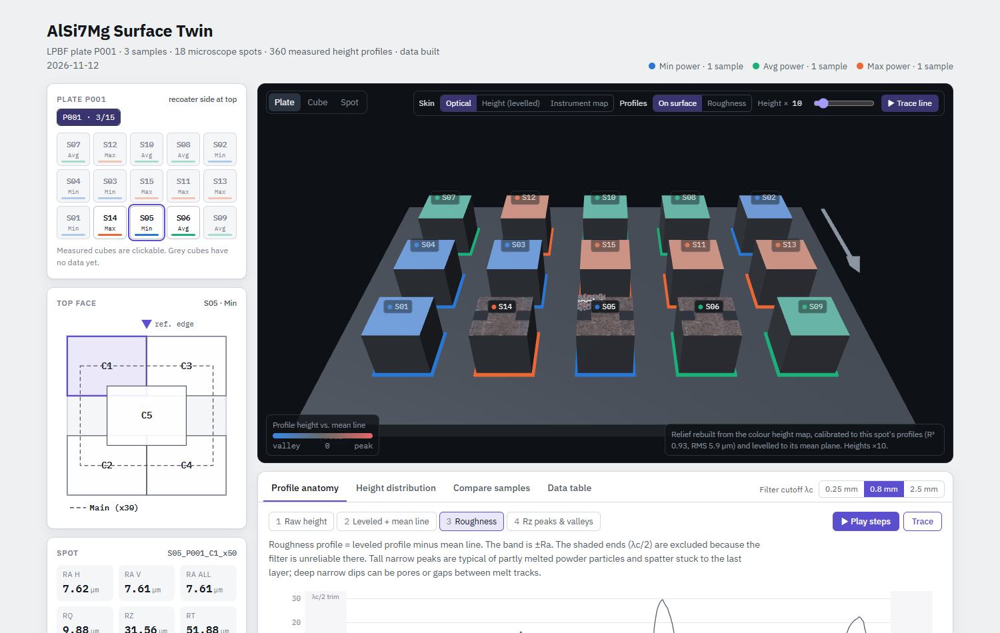

# LPBF Surface Digital Twin

A multimodal digital twin for top-surface roughness analytics in laser powder bed fusion (LPBF). It fuses the four data types exported by a 3D microscope for each measured field, namely height profiles (CSV), the colour height map (2D), a relief reconstructed from it (3D) and the optical micrograph, in one registered, interactive 3D view of plate, cube and field, and computes ISO 21920-2 roughness parameters live.

This repository accompanies the paper:

> A. Bendaouia, S. H. Duntu, J. Galarza, C. Altiparmak, M. T. Ahmed, J. Barron, J. Perez, F. Ahmed, J. Li. *A multimodal data fusion-based digital twin for top-surface roughness analytics in additive manufacturing.* 55th SME North American Manufacturing Research Conference (NAMRC 55), Manufacturing Letters, 2027.



## Data included

Three AlSi7Mg (A357) cubes of plate P001 (EOS M290; 1200 mm/s, 140 µm hatch, 30 µm layers), one per laser power level:

| Cube | Plate position | Laser power | Energy density |
|---|---|---|---|
| S05 | R3C3 | 210 W | 41.7 J/mm³ |
| S06 | R3C4 | 280 W | 55.6 J/mm³ |
| S14 | R3C2 | 350 W | 69.4 J/mm³ |

Each cube has six fields on its 12 mm top face: corners C1–C4 and centre C5 at x50 (5.99 × 4.49 mm, 2.079 µm/px) and an overview field Main at x30 (10.04 × 7.53 mm, 3.486 µm/px). Each field has 10 horizontal (H) and 10 vertical (V) height profiles. In total: 18 fields and 360 profiles. The other 12 cubes of the plate are shown in the layout without data.

```
raw/P001/<cube>/<cube>_P001_<field>/
    <id>_HL1..HL10.csv, <id>_VL1..VL10.csv   height profiles as exported by the microscope
    <id>_2D.png                               colour height map (lossless copy of the exported TIFF)
img/                                          optical images and height maps for display (JPEG)
data.json                                     twin data built from raw/ by build_twin_data.py
```

## Run the twin

Requires Python 3.9 or later and a web browser. The viewer runs offline (Three.js is in `vendor/`).

```bash
python twin_app.py              # serve the twin and open it in a browser window
python twin_app.py --no-window  # serve only; open the printed address in any browser
```

On Windows, double-click `Launch_Twin.bat`. Opening `index.html` directly from disk does not work, because the browser blocks loading `data.json` from a file; use `twin_app.py` or any local web server (e.g. `python -m http.server`).

## Rebuild the data from the raw files

```bash
pip install -r requirements.txt
python build_twin_data.py       # or: python twin_app.py --rebuild
```

For each field, `build_twin_data.py`:

1. reads the 20 profiles and masks the values the instrument repeats at the profile ends;
2. computes roughness: least-squares line removal, Gaussian filter with cutoff λc = 0.8 mm (ISO 16610-21) applied as a normalized convolution, λc/2 removed at each end, then Ra, Rq, Rz (mean over complete sampling lengths of λc), Rt, Rsk and Rku (ISO 21920-2);
3. rebuilds a 256 × 192 relief from the colour height map: the jet hue of each pixel gives a normalized height h, and z = a·h + b is fitted by least squares against the profiles of the same field; reliefs with R² < 0.5 are rejected.

The viewer recomputes the same parameters in the browser for any cutoff (0.25, 0.8 or 2.5 mm). The relief provides qualitative surface morphology; quantitative roughness values come from the measured profiles.

## Using the twin

- **Plate**: cubes at their build positions, coloured by power level; measured fields mapped onto the cube tops.
- **Cube**: the six fields at their positions on the top face.
- **Spot**: the relief of one field with its 20 profiles draped at their pixel coordinates; skins for the optical image, the levelled height or the instrument colour map; roughness profiles raised above the surface.
- Panels below the view: profile decomposition, height distributions, comparison of samples, and the data table.
- Deep links select a view, e.g. `index.html#S05_P001_C1_x50~plate`.

## Adding your own data

Place new fields under `raw/<Plate>/<Sample>/<Sample>_<Plate>_<Field>/` with the same file names, add the plate layout to `PLATE_POSITIONS` in `build_twin_data.py`, put display images in `img/`, and run `python build_twin_data.py`. Several plates are shown side by side with a plate selector.
